# Croft Manor viewer

A three.js page that shows Classic Croft Manor HD v2.3 (OBJ by TRJTA, exported from SketchUp). It covers the house, the grounds, the assault course, the ivy and the zipline trolley.

**See it in your browser: [sfatosu.com/croft-manor](https://sfatosu.com/croft-manor/)**

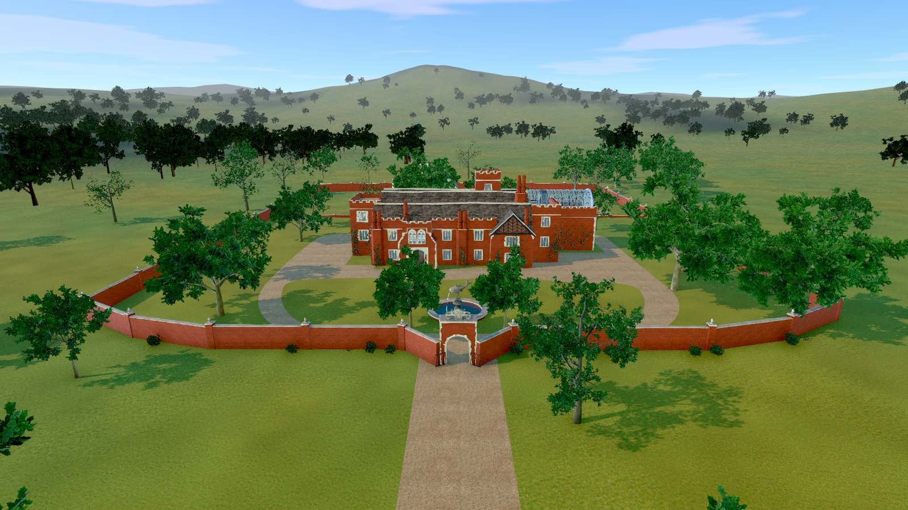

<p>
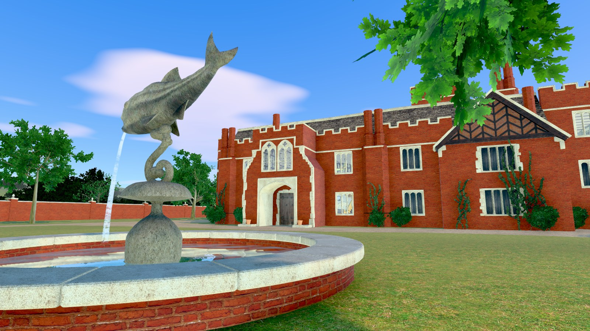
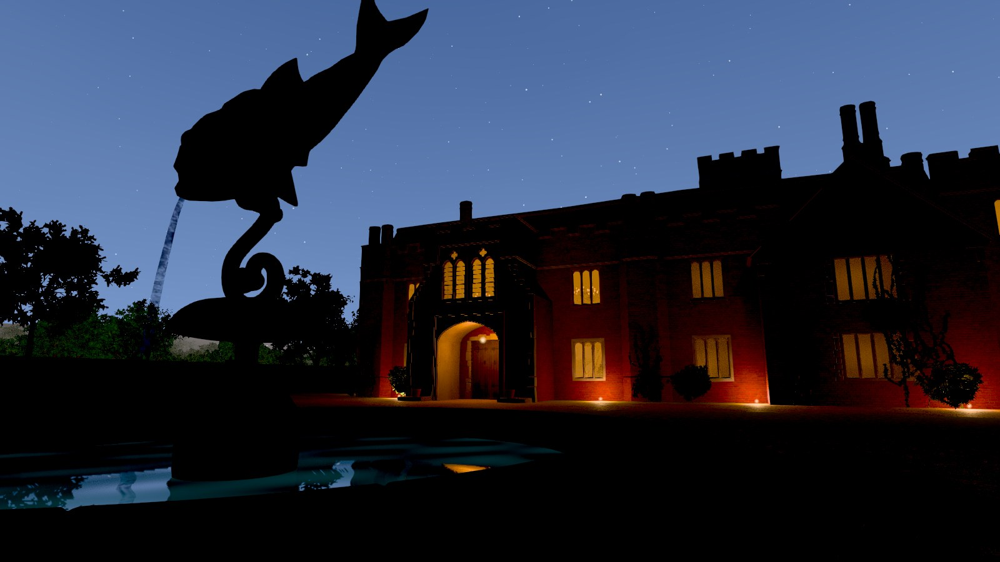
</p>
<p>
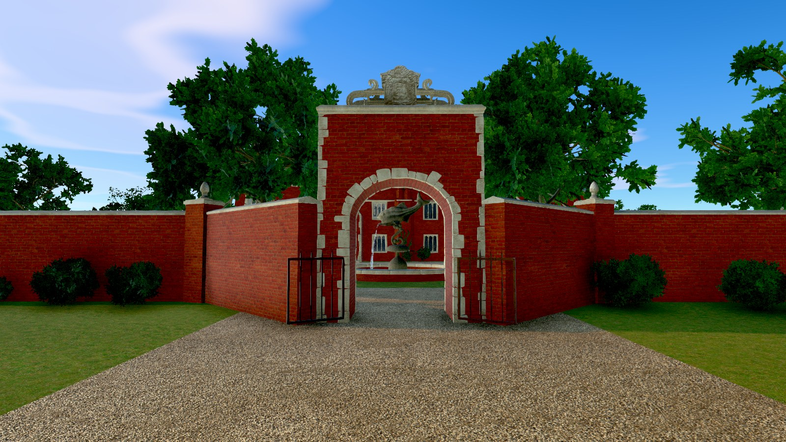
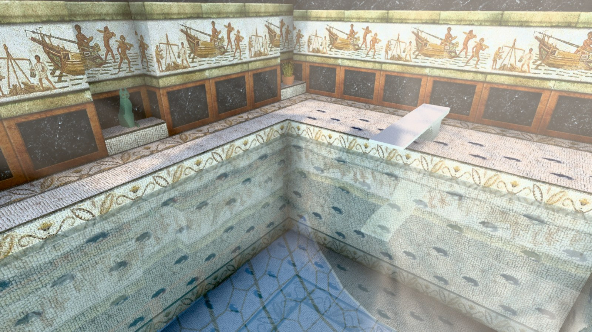
</p>
<p>
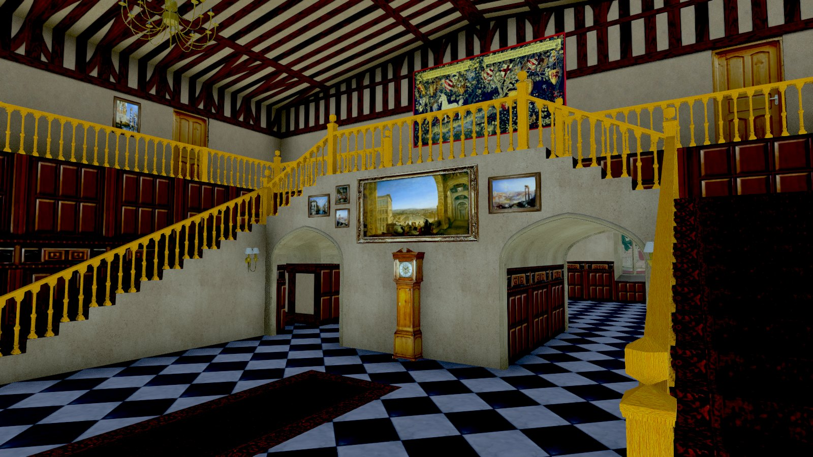
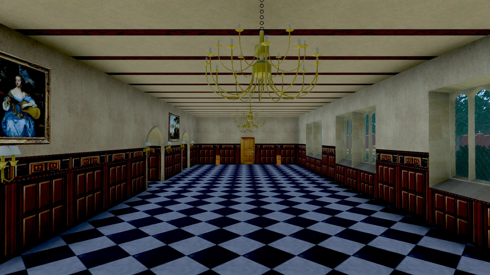
</p>

**Through the year.** The Season slider sets the day of the year: the sun takes that day's path, the trees come into leaf, turn yellow and brown and go bare, the grass changes, and in midwinter snow lies on the lawns, roofs and drive. The same view on 21 April, 10 July, 23 October and 19 January:

<p>
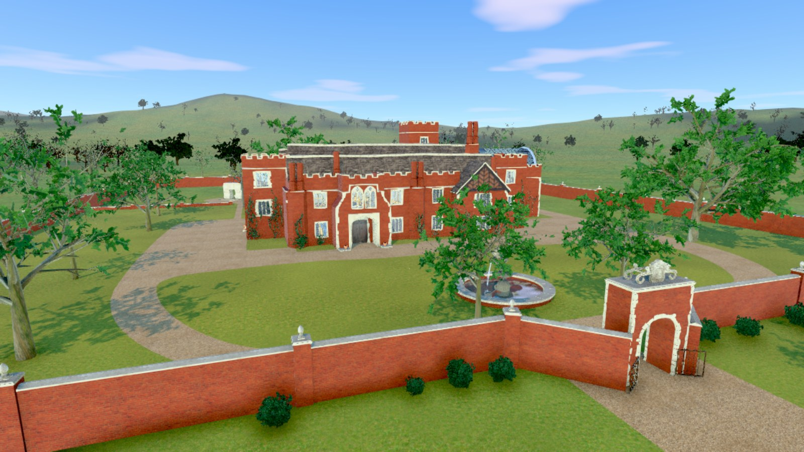
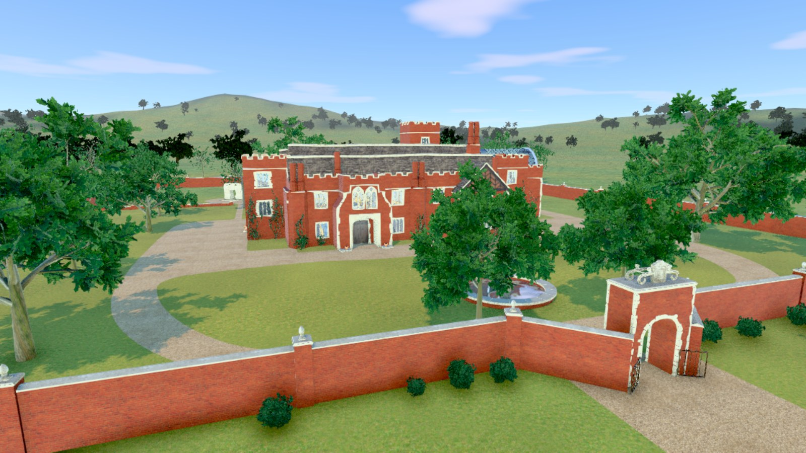
</p>
<p>
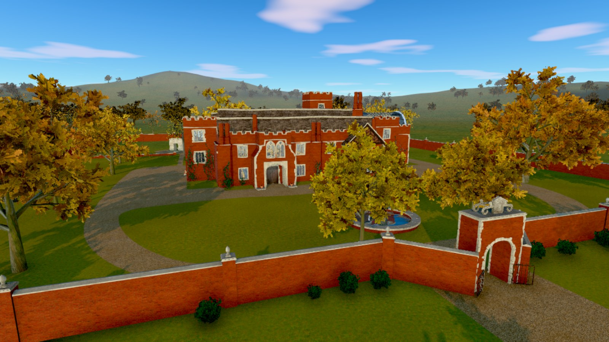
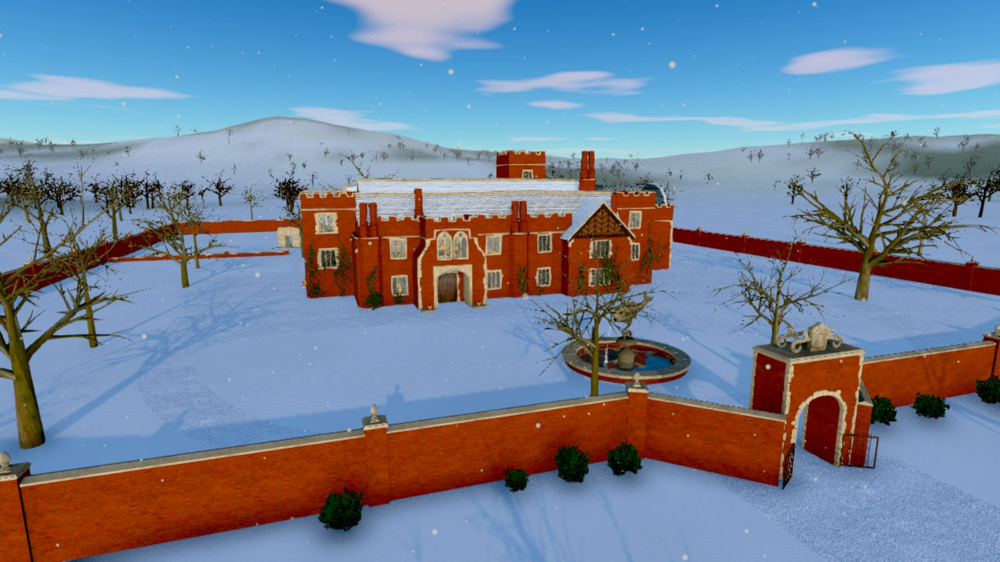
</p>

The model is **Classic Croft Manor HD v2.3 by TRJTA**, a fan remake of the classic FMV Croft Manor, published on [core-design.com](https://core-design.com/community_classicfmvmanorremake.html) under [CC BY-NC-SA 4.0](https://creativecommons.org/licenses/by-nc-sa/4.0/) ([download the original OBJ](https://icedrive.net/0/dfdFFOROA9)). It is not in this repository. The screenshots show it as converted and lit by this viewer, and are shared under the same licence. Core Design, Lara Croft and Tomb Raider are trademarks of Embracer Group AB; this is a fan project, not made, endorsed or sponsored by them.

## Run it

```sh
npm install
npm run build:model   # once: source/ -> public/manor.glb (about 35 s)
npm run dev           # http://localhost:5190
```

`source/` holds the unpacked RAR. macOS cannot open that solid RAR, so it was unpacked with `node-unrar-js`. `source/`, `build/` and `public/manor.glb` are left out of git.

## Versions

Every release is a git tag, and `CHANGELOG.md` says what each one changed. The panel shows the version you are looking at: "v0.10.0" when it is exactly a release, "v0.10.0 + changes" when there is work since (the dev server asks git each time the page loads, through `/version.json`).

- `npm run versions` lists the releases.
- `npm run serve:version -- v0.8.0` runs an earlier release on http://localhost:5191, next to the current one on :5190, to compare or to go back to. Add a port to run two at once (`-- v0.7.0 5192`). The first time, it checks the release out into `../CroftManorViewer-versions/v0.8.0` (outside this folder, so the dev server doesn't watch it) with a clone of `node_modules`; delete that folder to tidy up (`git worktree prune` then forgets it).
- To go back for good: `git checkout v0.8.0` (or branch from it).

Numbering: the middle number goes up for new features, the last one for fixes to the release before.

## What the model build does

`scripts/build-model.mjs`:

1. Copies `source/` to `build/work/`, then fixes three things there:
   - decodes the ivy's DXT5 `.dds` leaves to PNG;
   - renames `bump` lines to `map_Bump`, because obj2gltf only reads `map_Bump`;
   - points `cm_door_brown.jpg` at the `.png` that actually exists.
2. Converts the main OBJ, the trolley and the eight ivy OBJs with obj2gltf. Each one is flattened and then joined by material, so about 4,600 SketchUp groups become one mesh per material (157 draw calls).
3. Merges everything into one scene. The ivy goes under a node called `Ivy`, so the page can switch it off.
4. Sets material values that SketchUp doesn't export:
   - everything gets metalness 0 and roughness 0.82;
   - glass and water are see-through;
   - cut-out textures such as leaves and grilles get MASK, so they don't sort badly when blended.
5. Re-encodes textures as WebP, capped at 2048 px for colour and 1024 px for normal maps.

Change the caps with `COLOUR_MAX=4096 NORMAL_MAX=2048 npm run build:model`.

The result is about 83 MB: 36 MB of textures and 47 MB of geometry, with 763k triangles. The geometry is left uncompressed on purpose. Its texture coordinates run from -1153 to 671, which quantisation would blur.

## Using the page

- **Orbit**: drag to turn, right-drag to pan, scroll to zoom. Double-click a surface to fly towards it.
- **Walk**: click the view to capture the mouse. W A S D walk, Shift runs, Space jumps, and Esc frees the mouse. You're a capsule 1.8 m tall that collides with the whole estate, so stairs work and walls and furniture stop you. The collision tree (three-mesh-bvh) builds in a web worker in about 4 s after the model loads. If you switch to Walk from high up, you start on the drive.
- **Doors** (`src/doors.js`): every door in the model is a flat painted panel. The page tests each one: is there floor, headroom and open space on both sides? Two pass, the front door and the kitchen's garden door. They become hinged leaves (the front door a pair) that swing open as you come up to them, with a creak, and shut behind you. The other 17 are painted onto walls or open onto rooms that were never built (looking through one shows the top of the ceiling below), so they stay shut and block you.
- **Fly**: the same controls, and you fly faster the higher you are. Space goes up and C goes down. Switching to Fly lifts you over the gate first, for the view from above.
- **Go through walls** (off at first): with it off, walls stop you in every mode, including Orbit (turning and zooming stop at a wall; jumping to a place may pass through). With it on, Fly and Orbit go anywhere, and Walk ignores walls but still stands on floors (over a room that was never built it holds your height).
- **Water**: the indoor pool, the fountain and the assault-course pond are mirrors with procedural ripples and a Fresnel blend (`src/water.js`). Only the nearest water surface in view, within 55 m, renders a reflection each frame, at half resolution. The fountain's jet flows.
- **Ivy**: the eight ivy OBJs come centred on the origin, meant for placing by hand (TRJTA placed them in Lumion). `src/ivy.js` puts each one on a plain stretch of brick, found by scanning the facades with rays.
- **Landscape** (`src/landscape.js`): the OBJ stops at the estate walls, so the page adds the country around it.
  - Oaks and ashes from ez-tree (MIT, procedural), instanced, on open lawn inside the walls and in a belt outside them. They sway in the wind, and in Walk mode their trunks stop you.
  - The entrance as in TRJTA's renders: two full oaks either side of the path just inside the gate, a close row of dense shrubs along the front and back of the house, and clumps of low shrubs outside the front wall, thick by the gate and thinning away from it. Shrubs stop you in Walk mode.
  - About 1,400 far trees, drawn as billboards made from the same trees.
  - Rolling hills from 420 m out, with fields and woods tinted in.
  - The drive carries on past the gate.
- **Look**:
  - `src/look.js` is a custom tone-mapping curve: Neutral, slightly warmer and a touch more saturated.
  - `src/materials.js` sets the outdoor colours to match TRJTA's Lumion renders. They were measured from his render over the gate (sunlit lawn about rgb(107, 139, 65), brick about rgb(181, 118, 88), gravel a warm beige), then the same view was rendered here, sampled, and each tint nudged in linear light until they matched. Brick is tinted on the brick faces only, so the mortar between them stays a light grey and the courses still read.
  - The lawn and the fields around it share a grass shader that hides the texture's tiling, which from above read as a grid. It samples the texture in world space at two scales turned against each other, blended by noise. Each sample is divided by a blurred copy of itself, so the light and dark patches that repeat inside one tile flatten out. Drier and lusher patches drift over tens of metres on top. As both surfaces use it, the line where the estate's lawn meets the fields is gone.
  - Indoors, the sky light drops and the bounce light turns warm. By day the eye adapts as you go in (the exposure rises), and the rooms keep some of the light that sunlit floors and walls would bounce around. There is no real bounce light here, and the great hall never gets direct sun: the gallery round it catches the light from its high windows.
  - **Sunbeams** (`src/sunbeams.js`, Balanced and High): sunlight scattering in the air indoors. At half resolution, each pixel steps 24 times along its view ray to the first surface and asks the sun's shadow map whether that air is in sunlight; the result is weighted for forward scattering, blurred and added before tone mapping. It reuses the scene depth the ambient-occlusion pass renders, and is off outdoors and at night.
- **Quality** (`src/quality.js`):
  - *Balanced* (the default) adds ambient occlusion (N8AO) at half resolution, plus SMAA.
  - *High* runs the occlusion at full resolution.
  - *Fast* switches it off.
  - Resolution steps down when the frame rate drops below 38 fps and back up above 57.
  - N8AO 2.0.1 needs a small patch for three r187, which `patchN8AO` applies. Its automatic transparency mode is switched off: it drew the scene twice more each frame and emptied the sun's shadow map. If the post-processing ever throws an error, the page falls back to drawing directly rather than going blank.
- **Take the tour** (`src/tour.js`): about two and a half minutes in eight shots: over the estate, through the gate, round the fountain and in at the front door (it opens) to the great hall; then the gallery, the ballroom, the kitchen, the pool, the bedroom, the attic and the assault course, and back out. Each shot stays inside one space and the tour cuts between them with a dip to black, rather than flying through walls. When the page loads it sweeps a 20 cm ball along every camera path against the collision tree and the tree crowns, and warns in the console if any path touches (it prints "camera paths: clear of walls and trees"). Esc stops it.
- **Flybys**, beside the tour, are long single moves in the style of the old Tomb Raider flyby cameras: black film bars top and bottom, the camera banking into its turns (a roll about the view axis, composed onto its orientation as a quaternion), a wider lens and a slight fisheye that bends the edges of the picture (a barrel-distortion pass that keeps the corners in the corners), and the rush of air as it flies. Five: over the estate, the great hall, round the manor, the grounds, and the assault course. Esc, a click or W A S D leaves one.
- **Make a video** (`src/video.js`): pick a flyby and a format (YouTube 16:9 or an Instagram reel 9:16) and it makes an MP4 with sound: film bars, a title, the links and credits from `src/credits.js`, and an end card. Frames are drawn one at a time at a steady 30 a second and encoded with WebCodecs (H.264 and AAC). The sound is rendered on an OfflineAudioContext from the same camera path, and both are muxed with mp4-muxer (MIT). It needs Chrome or another browser with WebCodecs.
- **Sound** (`src/sound.js`) is all synthesised with Web Audio, with no files. It starts off, because browsers only allow sound after a click.
  - By day there's birdsong; at night, crickets and the odd owl.
  - Outdoors there's a breeze, and the fountain gets louder as you get near it.
  - The grandfather clock ticks in the hall.
  - In Walk mode, footsteps change with the surface: stone, gravel or grass.
- **Save a picture** downloads the current view as a PNG, without the panel.
- **Place** jumps to a saved view: from above (over the gate, as in the renders, and straight down), the front of the house, the fountain, and the rooms. To add one, use "Copy this view" and paste the line into `public/viewpoints.json`.
- **Season** (`src/season.js`): a slider for the day of the year, with ▶ to run a year in a minute.
  - The sun takes its real path for that date: its declination, the equation of time, and British Summer Time from late March to late October. Midwinter noon sun is 15° up, midsummer 62°; sunrise and sunset match London's.
  - The trees come into leaf over April and May, in a fresh yellowish green. They turn in October, some butter-yellow and some orange-brown, and drop their leaves through November, bare until spring. Each tree runs a few days early or late. Each leaf has its own random number, so the crowns thin leaf by leaf, and their shadows thin with them (the shadow pass uses the same shader). The far trees follow too, swapping to a bare picture of the same tree.
  - The grass is lush in spring and a little parched by late August, then dull in winter (late May is the calibrated colour).
  - Snow lies from about 21 December to early February, on the lawns, fields, drive, gravel and roofs, patchy as it comes and goes, with snow falling around you outdoors. Footsteps crunch in it. The shrubs and the ivy stay green.
  - Birds are busiest in spring and few sing in winter; crickets only sing on summer nights.
- **Weather** (`src/weather.js`): worked out for each day and hour, or set in the panel (clear, cloudy, overcast, rain, fog, snow). Spring has fluffy clouds, summer clear skies, winter grey overcast (a grey veil over the sky, and in the sky that lights the scene, so the light is grey too). About half the autumn days have showers, with rain streaks, wet glossy ground and the sound of it; some late-autumn mornings are foggy.
  - Snow and rain land only where the sky reaches: `buildSkyMap` renders the estate once from straight above, keeping the height of the highest surface at each point, and `weatherShader` (on every outdoor material) whitens or wets a surface only where it is that highest surface and faces up.
  - The fountain and the assault-course pond freeze in deep winter (the fountain stops), the shrubs and branches carry snow, and a snowman (`src/snowman.js`) stands on the front lawn from 21 December and melts in February.
- **Time**: the sun follows its real path over Surrey on the chosen day, with the front of the house facing south. The ▶ button runs a day in two minutes, and Compass turns the sun's path. From about 9° above the horizon the lamps come on (`src/lamps.js`):
  - every chandelier candle, wall sconce and kitchen tube gets a flame or glow, found by splitting the merged fitting meshes into pieces (one draw call for all the flames);
  - eight point lights follow you to the nearest fittings, outdoor ones first when you're outside;
  - outside there's a porch lantern, and floodlights at the foot of the front facade;
  - windows glow warm when you're outside;
  - at night the moon lights the estate, and there are stars and a navy sky (`src/sky.js`).
- Sliders set the brightness. Checkboxes switch the ivy and the shadows on and off.
